# FinNest — AI-Native Specification (extracted from SIT)

Source: `family-finance-doc-vault`, branch `feature/commitments-and-entrykind` (Spring Boot 3.3 / Java 21, React 18, PostgreSQL 17). Extracted 31 Oct 2026, read-only. Mode: **specs only, no rebuild**.
Supporting detail: `raw/business-rules.md` (163 rules), `raw/interfaces.md` (96 endpoints, 24 screens, 3 jobs), `raw/domain-model.md` (24 entities).
All credentials appear as env-var placeholders (`${JWT_SECRET}`, `${SPRING_DATASOURCE_URL}`, `${SPRING_DATASOURCE_PASSWORD}`, `${GEMINI_API_KEY}`, `${MAIL_USERNAME}`, `${MAIL_PASSWORD}`, `${FILE_STORAGE_PATH}`); no values are reproduced.

## 0. P0 decision (checkpoint #1)

_Pending: which capabilities below are P0, and which to drop deliberately._

## 1. Capabilities

| # | Capability | What the system must do | Rules | Status in SIT |
|---|---|---|---|---|
| C1 | Family accounts & access | Register a family, log in, 15-min sessions with refresh, OWNER sees all, MEMBER sees own; strict family isolation | AUTH, TEN | Works; budget delete and physical-vault reads not isolated; refresh unbounded |
| C2 | Money ledger | One entry table (DEBIT/CREDIT) that moves linked balances and classifies each entry (EntryKind) with edit history | TXN | Works; no amount validation; ledger "Pay" bypasses it |
| C3 | Bank accounts & cards | Balances and card outstanding derived from the ledger; utilisation, low-balance alert | BANK | Balance has two sources (ADR-001) |
| C4 | Loans | Reducing-balance EMI split (monthly or daily/365), disbursal, exact reversal, overdue alert | LOAN | Works via expenses; ledger path loses the split |
| C5 | Chit funds | Auction schedule, installments, allotment, position in net worth | CHIT | Pending count written by two paths |
| C6 | Deposits & investments | FD/RD tracking, SIP contributions, returns %, asset classes | DEP, INV | Maturity and current value are manual |
| C7 | Udhaar (peer lending) | Lent/borrowed with principal, repaid, outstanding | UDH | Never auto-settles; overdue alert dead |
| C8 | Income, projects, goals | Income sources, project budgets and burn, goals with priority-weighted allocation | INC, PROJ, GOAL | Income amount grows per receipt |
| C9 | Budgets & alerts | Monthly category budgets, rollover, 80%/100% alerts, email | BUD | Counts EMIs/SIPs as spend; alerts only on page view |
| C10 | Commitments planner | Monthly plan: income, must-pay, living, pausable; planned and safe surplus | CMT | New, works |
| C11 | Scheduled payments | Upcoming EMI/SIP/RD/chit installments, manual mark-paid, auto-chain next | SCH | Daily job is a no-op; invisible to balances |
| C12 | Money cockpit | Net worth, allocation, 3-month cash flow, year-end projection, idle-cash warning | NW | Averages and buckets have errors |
| C13 | Digital document vault | Upload (PDF/PNG/JPEG/WEBP ≤10 MB), versions, thumbnails, share by email | DOC | Version numbering and latest-delete bugs |
| C14 | Physical almirah vault | Shelf/holder/folder location, check-out/in custody log, stats | VAULT | Double check-out possible; cross-family read |
| C15 | AI assist | Document extraction (expiry, filing suggestion), schedule parsing, goal advice | DOC-14..16, AI | Schedule parser never sees the file; all docs sent to Gemini |
| C16 | Reminders & digests | Expiry reminders 30/14/3 days, Sunday spend digest, in-app inbox | NOTIF | Digest window 8 days |
| C17 | Data import | Workbook → commitments/chit schedule; Excel sync script | interfaces §4 | Sync script has secrets and SQL injection |

## 2. Non-functional requirements (inferred)

| Area | Requirement from legacy | Evidence / note |
|---|---|---|
| Scale | One household per tenant, a handful of users, thousands of ledger rows per year; in-memory filters and N+1 queries are tolerated today but full-table `findAll()` scans cross tenants | interfaces §6 item 11 |
| Batch windows | 01:00 due-payment check, 08:00 document expiry, Sunday 18:00 digest, all Asia/Kolkata | interfaces §3 |
| Startup | EntryKind backfill on every start (whole table) | BR-TXN-09 |
| Money precision | BigDecimal, paise (2 dp) HALF_UP; rupee rounding for EMI and display; en-IN formatting | LOAN-03, NW-15 |
| Uploads | 10 MB, content-sniffed types, local disk, unencrypted at rest | DOC-01/02, interfaces §5.4 |
| Security | JWT HS key ≥32 bytes from env, 15-min tokens, BCrypt, family isolation as 404, generic errors with ref id | AUTH-07..09, TEN-06 |
| Privacy | Full document content and family names go to a third-party LLM; card/account numbers stored and returned in plain text | interfaces §6 items 5, 8 |
| Email | Gmail SMTP, async, failures only logged; hardcoded no-reply sender | interfaces §5.2 |
| Schema | `ddl-auto: update`, no migrations | interfaces §0 |
| Availability | Single monolith + Postgres; no retries or timeouts on AI calls | interfaces §5.3 |

## 3. Known defects carried as SUSPECT rules (44)

The behaviour contract marks 44 rules `SUSPECT:`; they are the current behaviour, not the intended one. A reimagined system should decide each one rather than copy it. Most important: BR-BUD-10 and BR-VAULT-07 (cross-family access), BR-SCH-04 and BR-BANK-02 (two balance sources, ADR-001), BR-AI-01 (schedule parser invents installments), BR-LOAN-02 (0.5% read as 50%), BR-TXN-12 (negative amounts), BR-BUD-02 (EMIs counted as spending), BR-NW-08/09 (cockpit averages and double-counted income), BR-AUTH-10 (unbounded refresh).

## 4. Domain Model


Base: all entities extend `BaseEntity` (id UUID PK, createdAt, updatedAt). Ownership: `TenantBaseEntity` adds `tenant_id` UUID NOT NULL (non-updatable) and `user_id` UUID nullable, filled by `TenantListener`. All entities use it except Tenant, User (own tenant_id NN) and DocumentVersion (no tenant column; scoped only through its Document). NN = `nullable=false`.

24 entities, 21 JPA-mapped relationships.

### Entities

| Entity | Table | Purpose | Key fields | Stored totals / derived | Relationships |
|---|---|---|---|---|---|
| Tenant | tenants | Household/account | name NN, plan NN | – | tenant_id elsewhere is a bare UUID |
| User | users | Login identity | tenantId NN, email NN unique, role NN, password_hash | – | – |
| AssetClass | asset_classes | Asset category lookup | name | – | – |
| BankAccount | bank_accounts | Bank account | bankName, accountType, openingBalance, currentBalance | **currentBalance** stored+mutated, also recomputed on read | target of many N:1 |
| CreditCard | credit_cards | Credit card | creditLimit, openingOutstanding, billingCycleDate, dueDate | currentOutstanding transient, derived on read | – |
| Loan | loans | Borrowed loan | principalAmount, outstandingAmount, emiAmount, interestRate, remainingTenure, interestMethod | **outstandingAmount, remainingTenure** | N:1 BankAccount |
| ChitFund | chit_funds | Chit membership | totalValue, monthlyInstallment, durationMonths, pendingInstallments, isAllotted | **pendingInstallments** | N:1 BankAccount |
| Deposit | deposits | FD/RD | type, principalAmount, maturityAmount, monthlyDepositAmount, totalDeposited, maturityDate | **totalDeposited** | N:1 BankAccount |
| PeerLending | peer_lendings | Udhaar GIVEN/TAKEN | type, amount (outstanding), principalAmount, repaidAmount, settled | **amount, repaidAmount, principalAmount** | – |
| Investment | investments | MF/stocks/gold | type, name, investedAmount, currentValue (manual) | **investedAmount** | – |
| IncomeSource | income_sources | Income stream | sourceName, amount, frequency | **amount** | – |
| Project | projects | Budgeted project | name, status, priority, budget, customFieldsConfig | – | – |
| ProjectExpense | project_expenses | Project line item | amount, date, category | – | N:1 Project, N:1 Expense |
| Expense | expenses | Ledger entry (hub) | amount NN, category NN, expenseDate NN, type, madeAgainst, loanPrincipalPortion, loanInterestPortion, editHistory, kind | kind recalculated on every save | 9 × N:1 (BankAccount, Loan, ChitFund, PeerLending, Investment, Deposit, Project, IncomeSource, CreditCard) |
| Budget | budgets | Monthly category budget | category NN, amount NN, month(7) NN, rollover, emailAlert | – | – |
| Goal | goals | Savings goal | targetAmount NN, currentAmount NN, targetDate NN | **currentAmount** | N:1 BankAccount |
| Commitment | commitments | Recurring obligation | name NN, group enum NN, frequency enum NN, amount, dueDay, active | – | N:1 Loan, N:1 ChitFund |
| ScheduledPayment | scheduled_payments | Upcoming EMI/SIP/RD | amount, transactionType, referenceType, referenceId (polymorphic), dueDate, status (all NN) | – | N:1 BankAccount NN |
| BankTransaction | bank_transactions | Posted scheduled payment | amount, type, referenceType, referenceId (polymorphic), transactionDate | – | N:1 BankAccount NN |
| Document | documents | Vault file | name, type, category, file_path, size, uploaded_by NN; expiry_date; extracted_data, tags jsonb; associated_entity_type/id | – | 1:N DocumentVersion, 1:1 PhysicalLocation (cascade ALL, orphanRemoval) |
| DocumentVersion | document_versions | Earlier file version | version_number, file_path, size, uploaded_by | – | N:1 Document |
| PhysicalLocation | physical_locations | Paper original location | is_original_present, almirah_id NN, shelf/folder/slot, last_borrowed_at | – | 1:1 Document |
| PhysicalDocumentLog | physical_document_logs | Custody log | document_id (bare UUID), action_type, performed_by | – | – |
| Notification | notifications | User notification | message NN, is_read NN, document_id (bare UUID) | – | – |

### ER Diagram

```mermaid
erDiagram
    TENANT ||--o{ USER : "tenant_id (logical)"
    BANK_ACCOUNT ||--o{ LOAN : "linked_bank_account_id"
    BANK_ACCOUNT ||--o{ CHIT_FUND : "linked_bank_account_id"
    BANK_ACCOUNT ||--o{ DEPOSIT : "linked_bank_account_id"
    BANK_ACCOUNT ||--o{ GOAL : "linked_bank_account_id"
    BANK_ACCOUNT ||--o{ SCHEDULED_PAYMENT : "bank_account_id"
    BANK_ACCOUNT ||--o{ BANK_TRANSACTION : "bank_account_id"
    BANK_ACCOUNT ||--o{ EXPENSE : "linked_bank_account_id"
    LOAN ||--o{ EXPENSE : "linked_loan_id"
    CHIT_FUND ||--o{ EXPENSE : "linked_chit_fund_id"
    PEER_LENDING ||--o{ EXPENSE : "linked_peer_lending_id"
    INVESTMENT ||--o{ EXPENSE : "linked_investment_id"
    DEPOSIT ||--o{ EXPENSE : "linked_deposit_id"
    PROJECT ||--o{ EXPENSE : "linked_project_id"
    INCOME_SOURCE ||--o{ EXPENSE : "linked_income_source_id"
    CREDIT_CARD ||--o{ EXPENSE : "linked_credit_card_id"
    PROJECT ||--o{ PROJECT_EXPENSE : "project_id"
    EXPENSE ||--o{ PROJECT_EXPENSE : "expense_id"
    LOAN ||--o{ COMMITMENT : "linked_loan_id"
    CHIT_FUND ||--o{ COMMITMENT : "linked_chit_fund_id"
    DOCUMENT ||--o{ DOCUMENT_VERSION : "document_id"
    DOCUMENT ||--o| PHYSICAL_LOCATION : "document_id"

    TENANT { uuid id PK string name string plan }
    USER { uuid id PK uuid tenant_id string email string role }
    BANK_ACCOUNT { uuid id PK uuid tenant_id decimal opening_balance decimal current_balance }
    CREDIT_CARD { uuid id PK uuid tenant_id decimal credit_limit decimal opening_outstanding }
    LOAN { uuid id PK uuid tenant_id decimal outstanding_amount int remaining_tenure }
    CHIT_FUND { uuid id PK uuid tenant_id decimal monthly_installment int pending_installments }
    DEPOSIT { uuid id PK uuid tenant_id string type decimal total_deposited }
    PEER_LENDING { uuid id PK uuid tenant_id string type decimal amount decimal repaid_amount }
    INVESTMENT { uuid id PK uuid tenant_id decimal invested_amount decimal current_value }
    INCOME_SOURCE { uuid id PK uuid tenant_id decimal amount string frequency }
    PROJECT { uuid id PK uuid tenant_id decimal budget string status }
    PROJECT_EXPENSE { uuid id PK uuid project_id uuid expense_id decimal amount }
    EXPENSE { uuid id PK uuid tenant_id decimal amount string type string kind }
    GOAL { uuid id PK uuid tenant_id decimal target_amount decimal current_amount }
    COMMITMENT { uuid id PK uuid tenant_id string commitment_group decimal amount }
    SCHEDULED_PAYMENT { uuid id PK uuid bank_account_id uuid reference_id string status }
    BANK_TRANSACTION { uuid id PK uuid bank_account_id decimal amount uuid reference_id }
    DOCUMENT { uuid id PK uuid tenant_id string category date expiry_date }
    DOCUMENT_VERSION { uuid id PK uuid document_id int version_number }
    PHYSICAL_LOCATION { uuid id PK uuid document_id string almirah_id }
```



Not drawn (no mapped relationship): ASSET_CLASS, BUDGET, NOTIFICATION, PHYSICAL_DOCUMENT_LOG.

### Stored totals and who mutates them

| Entity.field | Mutated by |
|---|---|
| BankAccount.currentBalance | expense/ExpenseController.java:205-213; transaction/BankTransactionService.java:43,46; recomputed on read portfolio/BankAccountController.java:23-46 |
| Loan.outstandingAmount | ExpenseController.java:235-246; portfolio/LoanEventListener.java:40 |
| Loan.remainingTenure | LoanEventListener.java:45 |
| ChitFund.pendingInstallments | ExpenseController.java:262,266; portfolio/ChitFundEventListener.java:37 |
| Deposit.totalDeposited | ExpenseController.java:342-350; portfolio/DepositEventListener.java:37,39 |
| PeerLending.amount/repaidAmount/principalAmount | ExpenseController.java:280-300; portfolio/PeerLendingController.java:35,54 |
| Investment.investedAmount | ExpenseController.java:316-324 |
| IncomeSource.amount | ExpenseController.java:405-414 |
| Goal.currentAmount | goal/GoalController.java:36,68 |
| Expense.loanPrincipalPortion | ExpenseController.java:185,233 |
| CreditCard.currentOutstanding (derived) | portfolio/CreditCardController.java:23-57 |

### Gaps
- BankAccount.currentBalance has two inconsistent sources: writers add/subtract on the stored value; the read path rebuilds from openingBalance ± linked Expenses and ignores BankTransaction postings.
- Polymorphic links (ScheduledPayment/BankTransaction.referenceId, Document.associatedEntityId, PhysicalDocumentLog/Notification.documentId) have no FK; schema is `ddl-auto: update`, no migrations.
- DocumentVersion has no tenant_id; isolation relies on loading via Document.
- Sensitive columns exist (accountNumber, iban, cardNumber, password_hash); no values copied.

## 5. Interface Contracts


Repo: family-finance-doc-vault (branch feature/commitments-and-entrykind, read-only analysis)
`B/` = backend/src/main/java/com/finnest/ · `F/` = frontend/src/ · `R/` = backend/src/main/resources/

### 0. Cross-cutting

| Aspect | Behaviour | Evidence |
|---|---|---|
| Auth | Stateless JWT (HS-key from `${JWT_SECRET}`, Base64, ≥32 bytes, startup fails otherwise); 15-min expiry; claims `sub`=email, `id`, `role`, `name` | B/auth/JwtService.java:167-225, R/application.yml:50-51 |
| Public paths | `/`, `/index.html`, `/favicon.ico`, `/vite.svg`, `/assets/**`, `/api/auth/**`, `/api/public/**`; everything else authenticated | B/auth/SecurityConfig.java:61-65 |
| CSRF | Disabled (bearer tokens) | SecurityConfig.java:58 |
| Roles | `ROLE_OWNER`, `ROLE_MEMBER` (free-form string `users.role`); no `@PreAuthorize` anywhere — checks are inline `"MEMBER".equals(user.getRole())` | B/user/User.java:37,72-73 |
| Tenant scope | `TenantContext` set from the verified user's `tenant_id` in JWT filter, cleared after request | B/auth/JwtAuthenticationFilter.java:115-118,142-144 |
| Row visibility rule (most resources) | OWNER: all family rows; MEMBER: only rows whose `user_id` = self (list filter + update/delete check) | e.g. B/portfolio/LoanController.java:32-35,53-55 |
| Error mapping | RuntimeException("Unauthorized")→403; NotFound/NoSuchElement→404; upload>10MB→413; bad type→415; other→500 | B/common/GlobalExceptionHandler.java:19-78 |
| Frontend client | `fetch` with `Authorization: Bearer <token>` from localStorage; **any 401/403 → logout** | F/api/client.ts:4-30, F/store/authStore.ts:43-59 |
| Dev proxy | Vite proxies `/api` → `http://localhost:8080` | frontend/vite.config.ts:8-10 |
| CORS | `@CrossOrigin("*")` only on NotificationController | B/notification/NotificationController.java:13 |
| Timezone | JVM default forced to Asia/Kolkata (affects cron + LocalDate.now) | B/FinnestApplication.java:15 |
| Schema mgmt | `ddl-auto: update` (no migrations) | R/application.yml:16 |

Common entity envelope (all tenant entities): `id: uuid, createdAt, updatedAt, tenantId: uuid, userId: uuid` (B/common/BaseEntity.java:13-22, TenantBaseEntity.java:15-19). `userId` auto-filled from principal only when null (B/tenant/TenantListener.java:23-30).

---

### 1. Inbound – REST endpoints (96)

Notation: `auth: jwt` = any authenticated user; `roles` notes inline checks. "Entity" = JSON of the JPA entity incl. envelope.

### 1.1 Auth & health
```yaml
/api/auth/register:            # B/auth/AuthController.java:21
  post: {auth: public, body: {familyName, address, phone, members: [{name, email, password, phone, isAdmin: bool}]},
         res: {token}, effects: "insert tenants + users (bcrypt); first isAdmin (or first member) → OWNER, rest MEMBER"}  # AuthService.java:53-103
/api/auth/login:               # :26
  post: {auth: public, body: {email, password}, res: {token}}
/api/auth/refresh:             # :36  (permitAll path but needs valid bearer to resolve principal)
  post: {auth: bearer, body: none, res: {token}, note: "issues new 15-min token; jwt.refresh-expiration config unused"}
/api/public/health:            # B/common/HealthController.java:12
  get: {auth: public, res: {status: "UP", message}}
```

### 1.2 Family members  (B/user/FamilyMemberController.java)
```yaml
/api/family-members/profile: {get: {res: {familyName, address, phone}}}                       # :26
/api/family-members:
  get:  {res: "User[] (password @JsonIgnore)", note: "userRepository.findAll() then filter by tenant"}  # :38-45
  post: {roles: OWNER, body: {name, email, phone, password, role?}, res: User, note: "role is any free-form string"}  # :47-72
/api/family-members/{id}/role:
  put:  {roles: OWNER, query: {role: string}, res: User}                                      # :74-93
/api/family-members/{id}:
  delete: {roles: OWNER, res: 204, rule: "same tenant, not self"}                             # :95-117
```

### 1.3 Documents  (B/document/DocumentController.java; storage in DocumentService.java)
```yaml
/api/documents:
  post: {consumes: multipart, form: {file, category, description?, tags? (csv), associatedEntityType?, associatedEntityId?},
         res: Document, allowed: [application/pdf, image/png, image/jpeg, image/webp] (Tika byte sniff),
         effects: "disk write, documents + document_versions insert, thumbnail, async AI extraction"}   # :26 / Service:221-259
  get:  {query: {associatedEntityType?, associatedEntityId?}, res: Document[], member: own only}       # :39-59
/api/documents/{id}:
  get:    {res: Document, note: "tenant-guarded; NO member-ownership check"}                           # :146-149
  delete: {res: 204, effects: "deletes all version files + thumbnail"}                                 # :72
/api/documents/{id}/download:  {get: {res: "application/octet-stream attachment"}}                     # :61
/api/documents/{id}/thumbnail: {get: {res: "image/png | 404"}}                                         # :133
/api/documents/{id}/share:     {post: {body: {email}, res: 200, effects: "SMTP email w/ attachment to arbitrary address"}}  # :79
/api/documents/{id}/versions:
  get:  {res: DocumentVersion[]}                                                                       # :95
  post: {consumes: multipart, form: {file}, res: Document, effects: "new file, version row, AI re-extract"}  # :86
/api/documents/{id}/versions/{versionId}/download: {get: {res: octet-stream}}                          # :101
/api/documents/{id}/versions/{versionId}:          {delete: {res: 204}}                                # :112
/api/documents/{id}/versions/{versionId}/share:    {post: {body: {email}, res: 200}}                   # :119
# Document shape: {name, type(mime), size, category, filePath, uploadedBy, expiryDate, extractedData: json, description,
#                  tags: string[], versions[], physicalLocation, associatedEntityType, associatedEntityId}  (Document.java:20-62)
```

### 1.4 Physical vault  (B/document/PhysicalDocumentController.java)
```yaml
/api/physical-documents/stats: {get: {res: {totalDocuments, digitalOnly, physicalOnly, bothDigitalAndPhysical, missingOriginals, shelfUtilization: {shelf: n}}}}  # :22
/api/physical-documents/{documentId}:      {get: {res: PhysicalLocation|404, note: "NO tenant check (Service:97-99)"}}          # :27
/api/physical-documents/{documentId}/assign:   {post: {body: PhysicalLocation{isOriginalPresent, almirahId, shelf, holder, folder, subFolder, slot}, res: PhysicalLocation, effects: "upsert + log ASSIGN_LOCATION"}}  # :34
/api/physical-documents/{documentId}/check-out:{post: {body: {borrowerName, notes}, res: PhysicalLocation, effects: "log CHECK_OUT"}}  # :42
/api/physical-documents/{documentId}/check-in: {post: {body?: {location?: PhysicalLocation, notes?}, res: PhysicalLocation, effects: "log CHECK_IN"}}  # :50
/api/physical-documents/{documentId}/logs: {get: {res: PhysicalDocumentLog[]{documentId, actionType, performedBy, borrowerName, notes}, note: "NO tenant check (Service:216-218)"}}  # :64
```

### 1.5 AI  (B/ai/AIController.java, AdvisorController.java)
```yaml
/api/ai/parse-schedule:   # AIController.java:38
  post: {consumes: multipart, form: {file}, res: {scheduleType: LOAN_EMI|MUTUAL_FUND_SIP|RECURRING_DEPOSIT|CHIT_INSTALLMENT|OTHER, institutionName, description, installments: [{amount, dueDate}]},
         outbound: LLM, note: "file is NOT attached to prompt (DocumentParsingService.java:45-47 commented)"}
/api/ai/save-schedule:    # :56
  post: {query: {bankAccountId: uuid, referenceId?: uuid}, body: ParsedScheduleResponse, res: 200|400,
         effects: "insert scheduled_payments (PENDING, DEBIT) per installment; dates yyyy-MM-dd|dd-MM-yyyy|dd/MM/yyyy"}
/api/ai/recommendations:  # AdvisorController.java:28
  get:  {res: [{title, description, type: REALLOCATION|WARNING|OPTIMIZATION}], outbound: LLM, note: "all family goals/projects, no member filter"}
```

### 1.6 Notifications  (B/notification/NotificationController.java)
```yaml
/api/notifications:            {get: {res: Notification[]{message, isRead, documentId}}}   # :21
/api/notifications/unread:     {get: {res: Notification[]}}                                # :27
/api/notifications/{id}/read:  {put: {res: 200}}                                           # :33
/api/notifications/read-all:   {put: {res: 200}}                                           # :41
```

### 1.7 Standard CRUD portfolio resources
All follow: `GET` list (member: own only) · `POST` create (body=entity, tenant forced) · `PUT /{id}` (tenant + member-owner check; id/tenant/createdAt/userId preserved) · `DELETE /{id}` (same checks). Linked `BankAccount` stubs are tenant-guarded where noted.
```yaml
/api/bankaccounts:   {ops: [get, post, put/{id}, delete/{id}], file: B/portfolio/BankAccountController.java:49-89,
  entity: {bankName, accountHolderName, accountNumber, accountType, openingBalance, currentBalance (recomputed from linked expenses on read), name, iban}}
/api/creditcards:    {ops: [get, post, put/{id}, delete/{id}], file: CreditCardController.java:60-100,
  entity: {cardName, bankName, cardHolderName, cardNumber, creditLimit, openingOutstanding, billingCycleDate, dueDate, currentOutstanding (transient)}}
/api/loans:          {ops: [get, post, put/{id}, delete/{id}], file: LoanController.java:29-64, guardsLinkedAccount: true,
  entity: {lenderName, loanType, borrowerName, principalAmount, outstandingAmount, emiAmount, interestRate, months/remainingTenure, interestMethod, linkedAccount}}
/api/chitfunds:      {ops: [get, post, put/{id}, delete/{id}], file: ChitFundController.java:29-64, guardsLinkedAccount: true,
  entity: {organizerName, memberName, totalValue, monthlyInstallment, durationMonths, pendingInstallments, startDate, isAllotted, allottedAmount, paymentSchedule (JSON string), linkedAccount}}
/api/deposits:       {ops: [get, post, put/{id}, delete/{id}], file: DepositController.java:29-64, guardsLinkedAccount: true,
  entity: {type: FD|RD, name, accountHolderName, principalAmount, maturityAmount, interestRate, startDate, maturityDate, monthlyDepositAmount, totalDeposited, linkedAccount}}
/api/investments:    {ops: [get, post, put/{id}, delete/{id}], file: InvestmentController.java:20-53, entity: {type, name, ownerName, investedAmount, currentValue}}
/api/incomesources:  {ops: [get, post, put/{id}, delete/{id}], file: IncomeSourceController.java:20-53, entity: {sourceName, ownerName, amount, frequency, dateReceived}}
/api/peerlendings:   {ops: [get, post, put/{id}, delete/{id}], file: PeerLendingController.java:20-58, entity: {type: GIVEN|TAKEN, personName, ownerName, amount, date, expectedReturnDate, settled, principalAmount, repaidAmount}}
/api/projects:       {ops: [get, post, put/{id}, delete/{id}], file: ProjectController.java:20-53, entity: {name, status, budget, priority, customFieldsConfig, startDate, endDate}}
/api/projects/{projectId}/expenses: {ops: [get, post, delete/{id}], file: ProjectExpenseController.java:22-48, entity: {project, date, amount, description, category, expense}}
/api/asset-classes:  {ops: [get, post, delete/{id}], file: AssetClassController.java:22-49, entity: {name}, rules: "unique per tenant (case-insens.); delete blocked if used by investments"}
/api/goals:          {ops: [get, post, put/{id}, delete/{id}], file: B/goal/GoalController.java:21-73, entity: {name, targetAmount, currentAmount, targetDate, category, priority, linkedAccount}}
/api/goals/{id}/contribute: {post: {body: {amount}, res: Goal, effect: "currentAmount += amount"}}   # GoalController.java:57
```

### 1.8 Expenses (ledger core)  (B/expense/ExpenseController.java)
```yaml
/api/expenses:
  get:  {res: Expense[], member: own only}                                   # :172
  post: {body: Expense, res: Expense, tx: true, effects: "adjusts linked bank/loan/chit/peer/investment/RD/income balances; inserts project_expenses"}  # :197
/api/expenses/categories: {get: {res: string[]}}                              # :183
/api/expenses/{id}:
  put:    {body: Expense, res: Expense, effects: "reverse old + apply new balance effects; appends editHistory"}  # :208
  delete: {res: 200, effects: "reverse balance effects; delete project_expenses"}                                # :282
# Expense: {amount, category (not null), expenseDate, description, type: DEBIT|CREDIT, madeAgainst, linkedAccount, linkedLoan, linkedChitFund,
#           linkedPeerLending, linkedInvestment, linkedDeposit, linkedProject, linkedIncomeSource, linkedCreditCard, customFieldsData,
#           kind: EntryKind (derived), loanPrincipalPortion, loanInterestPortion (server-computed), editHistory}
```

### 1.9 Budgets  (B/budget/BudgetController.java, BudgetService.java)
```yaml
/api/budgets/summary:     {get: {query: {month: yyyy-MM}, res: [{id, category, limitAmount, rolloverAmount, spentAmount, percentage, alert, daysLeft, rollover, emailAlert}],
                           side_effects: "creates notifications + sends emails when >=80%/exceeded (Service:131-185)"}}   # :19
/api/budgets/obligations: {get: {query: {month}, res: {totalOutgoing, breakdown: {refType: amt}, obligations: ScheduledPayment[]}}}  # :24
/api/budgets:             {post: {body: {category, amount, month, rollover, emailAlert}, res: Budget, note: "upsert by tenant+category+month"}}  # :29
/api/budgets/{id}:        {delete: {res: 204, note: "NO tenant check — deleteById (Service:201-203)"}}  # :34
```

### 1.10 Commitments (new on this branch)  (B/commitment/CommitmentController.java)
```yaml
/api/commitments:
  get:  {res: Commitment[], member: own only}                                                      # :31
  post: {body: Commitment, res: Commitment, validation: "name, group, frequency required; amount>=0 unless linked; EVERY_N_MONTHS needs intervalMonths>=1 + startDate; dueDay 1-31; end>=start"}  # :49,103-117
/api/commitments/plan: {get: {query: {month?: yyyy-MM}, res: MonthPlan{month, income, mustPay, living, pausable, totalOutflow, plannedSurplus, safeSurplus, lines: [{id, name, group, category, amount, dueDay, active, source}]}}}  # :37 / CommitmentPlanner.java:33-40
/api/commitments/{id}:
  put:    {body: Commitment, res: Commitment}   # :57
  delete: {res: 200}                            # :70
# Commitment: {name, group: INCOME|MUST_PAY|LIVING|PAUSABLE, category, amount, frequency: MONTHLY|DAILY|EVERY_N_MONTHS, intervalMonths, dueDay,
#              startDate, endDate, active, linkedLoan{id}, linkedChitFund{id}, notes}  (links tenant-guarded :94-101)
```

### 1.11 Scheduled payments / transactions  (B/transaction/TransactionController.java)
```yaml
/api/transactions/scheduled/pending:        {get: {res: ScheduledPayment[]{amount, transactionType, referenceType, referenceId, bankAccount, dueDate, status, description}}}  # :47
/api/transactions/process-scheduled/{paymentId}:
  post: {res: "200 text | 400 failureReason", effects: "debit/credit bank_accounts.currentBalance, insert bank_transactions, publish PaymentProcessedEvent → Loan/Chit/Deposit listeners update record + auto-schedule next PENDING payment"}  # :28; BankTransactionService.java:136-174; *EventListener.java
```

---

### 2. Inbound – Frontend screens (F/App.tsx:66-99)

| Route | Component | Endpoints called |
|---|---|---|
| `/` | Landing | none |
| `/login` | Login | POST /api/auth/login |
| `/register` | Register | POST /api/auth/register |
| `/dashboard` (index), `/dashboard/portfolio` | PortfolioOverview | GET bankaccounts, investments, loans, deposits, goals, expenses, incomesources, chitfunds, creditcards, peerlendings, ai/recommendations |
| `/dashboard/vault` | Dashboard (+UploadModal, PreviewModal, ShareModal) | GET documents, notifications/unread, bankaccounts, loans, peerlendings, expenses, documents/{id}/download, /thumbnail; DELETE documents/{id}; PUT notifications/{id}/read, read-all; UploadModal: GET family-members, POST documents, GET documents/{id}, POST physical-documents/{id}/assign; PreviewModal: GET/POST versions, version download, DELETE version; ShareModal: POST share / version share |
| `/dashboard/physical-vault` | PhysicalVault | GET documents, physical-documents/stats, family-members, physical-documents/{id}/logs; POST check-out, check-in |
| `/dashboard/ledger` | Ledger | GET bankaccounts, transactions/scheduled/pending; POST process-scheduled/{id}, ai/parse-schedule, ai/save-schedule?bankAccountId (no referenceId sent) |
| `/dashboard/bank-accounts` | BankAccounts | GET bankaccounts, expenses; POST/PUT/DELETE bankaccounts |
| `/dashboard/credit-cards` | CreditCards | GET creditcards, expenses; POST/PUT/DELETE creditcards |
| `/dashboard/deposits` | Deposits | GET deposits, expenses; POST/PUT/DELETE deposits |
| `/dashboard/investments` | Investments | GET investments, expenses, asset-classes; POST/PUT/DELETE investments; POST/DELETE asset-classes |
| `/dashboard/loans` | Loans | GET loans, expenses; POST/PUT/DELETE loans |
| `/dashboard/chit-funds` | ChitFunds | GET chitfunds, bankaccounts, expenses; POST/PUT/DELETE chitfunds |
| `/dashboard/peer-lending` | PeerLending | GET peerlendings, expenses; POST/PUT/DELETE peerlendings |
| `/dashboard/income` | SideIncome | GET incomesources, expenses, bankaccounts; POST/PUT/DELETE incomesources; POST/DELETE expenses |
| `/dashboard/projects` | Projects | GET projects, expenses; POST/PUT projects; POST expenses |
| `/dashboard/expenses` | Expenses | GET expenses, expenses/categories, bankaccounts, loans, chitfunds, peerlendings, investments, deposits, projects, incomesources, creditcards; POST/PUT/DELETE expenses |
| `/dashboard/goals` | Goals | GET goals, ai/recommendations; POST goals, goals/{id}/contribute |
| `/dashboard/budgets` | Budgets | GET budgets/summary, budgets/obligations; POST budgets; DELETE budgets/{id} |
| `/dashboard/family` | FamilyMembers | GET family-members, family-members/profile; POST family-members; PUT /{id}/role; DELETE /{id} |
| `/dashboard/quick-logger` | QuickLogger | GET bankaccounts, creditcards, investments, incomesources; POST expenses (templates in localStorage `fin_quick_templates`) |
| `/dashboard/commitments` | Commitments | GET commitments, commitments/plan, loans, chitfunds; POST/PUT/DELETE commitments |
| (global) | SessionExpiryModal | POST /api/auth/refresh |

All `/dashboard/*` wrapped in `ProtectedRoute` (token presence only; F/App.tsx:34). Not wired to any screen: GET /api/documents/{id}/versions… (used), PUT /api/projects/{id} (used); unused by UI: GET/POST/DELETE /api/projects/{id}/expenses, GET /api/notifications, GET /api/physical-documents/{id}.

---

### 3. Inbound – Scheduled jobs & runners

| Name | Schedule (Asia/Kolkata) | What it does | Writes / outbound | Evidence |
|---|---|---|---|---|
| ReminderScheduler.checkExpiries | `0 0 8 * * *` daily 08:00 | All documents (all tenants); if expiry in exactly 30/14/3 days → notification + email to uploader | notifications; SMTP | B/notification/ReminderScheduler.java:45-77 |
| ReminderScheduler.sendWeeklySpendDigest | `0 0 18 * * SUN` Sun 18:00 | Per tenant: last-7-day DEBIT total, top category, budgets ≥80% → email **every** family member | SMTP (read-only DB) | :80-170 |
| PaymentSchedulerService.processDuePayments | `0 0 1 * * ?` daily 01:00 | Finds PENDING payments due ≤ today and **only logs** them (no notification, no processing) | logs only | B/scheduler/PaymentSchedulerService.java:27-48 |
| EntryKindBackfill (ApplicationRunner) | every startup | Re-derives `expenses.kind` for all rows; saves changed | expenses | B/expense/EntryKindBackfill.java:16-26 |
| DatabaseSeeder (CommandLineRunner) | startup, profile `dev` only | Creates demo tenant + OWNER with weak hardcoded password (password=****) and prints it | tenants, users | B/config/DatabaseSeeder.java:15-40 |

In-process async/event consumers: `AiExtractionService.processDocumentAsync` (@Async), `EmailService.*` (@Async), `LoanEventListener`, `ChitFundEventListener`, `DepositEventListener` (@EventListener on PaymentProcessedEvent). `DocumentService.generateThumbnailAsync` is self-invoked, so @Async does not apply (runs synchronously) — DocumentService.java:249,310.

---

### 4. Inbound – Import scripts

| Script | Input | Mechanism | Tables written | Notes |
|---|---|---|---|---|
| scripts/import_commitments.py | Workbook .xlsx (sheets "MONTHLY EXPENSES", "Income Sources", two chit sheets) + user email arg | Prints SQL to stdout, piped to `docker exec … psql` | UPDATE chit_funds (payment_schedule, pending_installments); INSERT commitments (skip if name exists) | Hardcoded heuristics: chit start months, lender-name prefix match, daily SIP amounts (:76-78,105-108). Single BEGIN/COMMIT. |
| scripts/sync_excel_to_db.ps1 | Latest `FinnEst_Master_Finance_*.xlsx` on Desktop (Excel COM) | Direct `psql` to localhost:5435 per row | INSERT expenses (linked bank acct), INSERT project_expenses; UPDATE projects.budget/status | Hardcoded DB password (`$env:PGPASSWORD='****'`, :13), hardcoded personal email (:35), hardcoded full account number (:44, `<account number>`); status cell interpolated unescaped into SQL (:135); bypasses app balance logic; force-kills headless Excel (:189) |

---

### 5. Outbound interfaces

### 5.1 Database (PostgreSQL)
Connection: `${SPRING_DATASOURCE_URL}`, `${SPRING_DATASOURCE_USERNAME}`, `${SPRING_DATASOURCE_PASSWORD}` — **non-empty defaults present** (R/application.yml:11-13). docker-compose exposes postgres:17 on host port 5435 with inline credentials (POSTGRES_PASSWORD=****, docker-compose.yml:7-10).

| Table | Written by |
|---|---|
| tenants | auth/register, DatabaseSeeder |
| users | auth/register, family-members POST/PUT/DELETE, DatabaseSeeder |
| documents, document_versions | /api/documents POST/DELETE, versions POST/DELETE, AiExtractionService (extractedData, expiryDate) |
| physical_locations, physical_document_logs | /api/physical-documents assign/check-out/check-in |
| notifications | AiExtractionService (expiring ≤30d), ReminderScheduler.checkExpiries, BudgetService.triggerBudgetNotification, mark-read endpoints |
| expenses | /api/expenses, EntryKindBackfill, sync_excel_to_db.ps1 |
| bank_accounts | CRUD; balance side-effects from expenses + process-scheduled |
| credit_cards, deposits, investments, income_sources, peer_lendings, loans, chit_funds, projects, goals, asset_classes | respective CRUD + expense side-effects + event listeners; chit_funds also import_commitments.py; projects also .ps1 |
| project_expenses | ProjectExpenseController, ExpenseController (linkedProject), .ps1 |
| budgets | /api/budgets |
| commitments | /api/commitments, import_commitments.py |
| scheduled_payments | ai/save-schedule, Loan/Chit/Deposit event listeners (next installment), process-scheduled (status) |
| bank_transactions | BankTransactionService.processScheduledPayment |

### 5.2 Email (Gmail SMTP)
Config: host smtp.gmail.com:587 STARTTLS, `${MAIL_USERNAME}`, `${MAIL_PASSWORD}` (R/application.yml:33-44). From header hardcoded to a `noreply@` address on a finnest domain (B/notification/EmailService.java:21,38). All sends @Async, failures only printed.

| Trigger | Recipients | Content type | Payload | Evidence |
|---|---|---|---|---|
| POST /api/documents/{id}/share | Arbitrary address from request body | multipart MIME + **file attachment** | doc name, file | DocumentService.java:423-431 |
| POST /api/documents/{id}/versions/{vid}/share | Arbitrary address | multipart + attachment | doc name, version no., file | :451-461 |
| Daily 08:00 expiry check | Uploader of document | text/plain | user name, doc name, expiry date | ReminderScheduler.java:225-233 |
| Sunday 18:00 digest | All users of each tenant with activity | text/plain | weekly spend total, top category + amount, at-risk budget count | :313-327 |
| GET /api/budgets/summary crossing 80%/100% (once per category+month+level, if budget.emailAlert) | All users of tenant | text/plain | category, limit, spent, remaining | BudgetService.java:162-183 |

### 5.3 AI / LLM
Provider: Google Gemini via Spring AI OpenAI-compatible client. Keys: `spring.ai.openai.api-key=${GEMINI_API_KEY}`, `base-url` = Google generativelanguage OpenAI-compat endpoint, `spring.ai.openai.chat.options.model=gemini-3-flash-preview` (R/application.yml:24-31; pom spring-ai-openai-spring-boot-starter).

| Call | Trigger / frequency | Data sent | Personal data | Evidence |
|---|---|---|---|---|
| AiExtractionService.processDocumentAsync | Every document upload and every new version (async) | Images: raw image bytes as media; PDFs: full Tika-extracted text (no length limit) + long prompt | **Yes** — full identity, banking, medical, property, tax docs; prompt also embeds hardcoded family member first names/relations | B/ai/AiExtractionService.java:127-165; DocumentParser.java:72 |
| DocumentParsingService.parseScheduleDocument | POST /api/ai/parse-schedule | System prompt + format instructions only; **document not attached** | No (but output is fabricated) | B/ai/DocumentParsingService.java:43-50 |
| FinancialAdvisorService.getRecommendations | GET /api/ai/recommendations (Goals + PortfolioOverview page loads) | All family goals (name, category, priority, target, current, deadline) and projects (name, status, priority, budget, dates) | Financial data; goal/project names free-text | B/ai/FinancialAdvisorService.java:250-276 |

No retry/timeout configuration; AI responses parsed as JSON with ad-hoc fence stripping (AiExtractionService.java:167-178).

### 5.4 File storage (local filesystem)
Root `${FILE_STORAGE_PATH}` (default `uploads`, R/application.yml:57) + `thumbnails/` subdir created at startup (DocumentService.java:194-198).
- Writes: `<uuid>_<sanitized name>` per upload/version (`Files.copy`, :76,:123 → lines 228,275), `thumbnails/<docId>.png` 200px (PDFBox/ImageIO, :311-339).
- Deletes: on document/version delete (:412-415, :441).
- Files unencrypted at rest; no virus scan; Tika type sniff only.

### 5.5 Other HTTP
None found in backend (no RestTemplate/WebClient/HttpClient). Frontend makes no third-party calls (only same-origin `/api`).

---

### 6. Risks surfaced while cataloguing

1. **Cross-tenant delete** — DELETE /api/budgets/{id} uses `deleteById` with no tenant check (BudgetService.java:201-203).
2. **Cross-tenant read** — GET /api/physical-documents/{documentId} and /{documentId}/logs have no tenant filter (PhysicalLocationService.java:97-99, 216-218).
3. **Possible cross-tenant overwrite via POST** (inferred) — create endpoints accept a client-supplied `id`; `repository.save()` would merge into an existing row of another family (tenant_id is `updatable=false`, so the row stays in that family but its contents change). `userId` is also client-assignable on create. Verify with a test.
4. **AI schedule parser hallucinates** — the uploaded file never reaches the model (DocumentParsingService.java:45-47); the results can be saved as real pending payments.
5. **Sensitive personal data to a third-party LLM** — every uploaded document's full content, plus family names typed into the prompt (AiExtractionService.java:139,151-164); no opt-out or redaction.
6. **Unrestricted document exfiltration by email** — share endpoints accept any recipient; no audit log (DocumentService.java:423-461).
7. **Secrets/PII in source** — .ps1 DB password, email and full account number (:13,:35,:44); default DB password in application.yml:13; docker-compose credentials; dev seeder weak password; JwtService.java:188 embeds a prefix of a previously committed sample key (`'404E****'`) as a denylist.
8. **Plaintext card and account numbers** stored and returned in full (CreditCard.java:15, BankAccount.java:15).
9. **GET with side effects** — /api/budgets/summary creates notifications and sends emails (BudgetService.java:131-185).
10. **Scheduled-payment job is a no-op** — it only logs (PaymentSchedulerService.java:37-45); payments are processed only when someone triggers them manually from the Ledger screen.
11. **Full-table scans across tenants** — `userRepository.findAll()`, `notificationRepository.findAll()`, `scheduledPaymentRepository.findAll()` filtered in memory (FamilyMemberController.java:41, BudgetService.java:151,211).
12. **Free-form roles** — owners can set any role string; any value other than "MEMBER" gets owner-level visibility (FamilyMemberController.java:69,91).
13. **403 logs the user out** — client.ts:27-29 treats permission denials as session expiry.
14. **Token in localStorage**, 15-min expiry with an unlimited refresh chain; `jwt.refresh-expiration` is never read.
15. **SQL injection in the .ps1 script** — the project status cell is interpolated unescaped (sync_excel_to_db.ps1:135).
16. **Spoofed From address** — the hardcoded `noreply` sender on Gmail SMTP will be rewritten or fail SPF/DMARC.

---

### Confidence & Gaps
- Endpoint inventory is complete from `@*Mapping` grep plus a full read of every controller. Entity field lists come from `private` field declarations; some `type`-like fields were checked separately.
- Not verified at runtime: whether the POST-with-id merge actually overwrites (risk 3), Jackson serialization of lazy relations, and whether Spring AI's OpenAI client handles Gemini image media correctly.
- Unknown: production hosting (a comment mentions a Render disk), whether the `dev` profile is ever on in SIT, and the SMTP account owner.
- No text aimed at manipulating automated analysis was found in source, config or scripts.
- SME questions: Is the family-name almirah prompt meant to be per-tenant? Is sending ID documents to Gemini covered by consent or a DPA? Should the 01:00 job auto-process or notify? Should MEMBERs be able to share documents externally?

## 6. Behaviour Contract (acceptance tests)

Paths: B = backend/src/main/java/com/finnest/ , F = frontend/src/ . Read-only extraction 2026-10-31.
Credentials/personal data are masked as placeholders.

### 1. Auth & sessions (AUTH)
### BR-AUTH-01 — Family needs at least one member
Given a registration with an empty member list / When submitted / Then rejected "Family must have at least one member". Source: B/auth/AuthService.java:54-56
### BR-AUTH-02 — Any already-registered email blocks the whole registration
Given 3 members where member 2's email exists / When registering / Then nothing is saved, error "Email already registered". Source: B/auth/AuthService.java:59-63
### BR-AUTH-03 — Registration creates one family (tenant), plan FREE
Given family name, address, phone / When registration succeeds / Then one tenant is created with plan "FREE". Source: B/auth/AuthService.java:66-70; B/tenant/Tenant.java:19
### BR-AUTH-04 — Admin flag maps to OWNER; fallback first member
Given members flagged isAdmin=true get OWNER and others MEMBER / When none is flagged / Then the first listed member is made OWNER; the JWT returned is for the first admin. Source: B/auth/AuthService.java:82-101
### BR-AUTH-05 — Passwords stored hashed, never serialised
Given any user save / Then password is BCrypt-hashed and excluded from JSON. Source: B/auth/SecurityConfig.java:50-52; B/user/User.java:32-34; B/auth/AuthService.java:80
### BR-AUTH-06 — Login by email + password
Given wrong credentials / When logging in / Then 401 "Invalid email or password." Given correct / Then a JWT is returned. Source: B/auth/AuthService.java:105-116; B/common/GlobalExceptionHandler.java:24-27
### BR-AUTH-07 — Token content and lifetime
Given a successful login / Then the JWT has subject = email, claims id, role, name, and expires after 900,000 ms (15 min). Param: jwt.expiration=900000. Source: B/auth/JwtService.java:55-78; backend/src/main/resources/application.yml:51
### BR-AUTH-08 — Token validity
Given a token whose subject matches an existing user and is unexpired / Then the request is authenticated and the family context is set from the user's tenant. Expired → 401 "JWT token has expired"; malformed → 401 "Invalid JWT token". Source: B/auth/JwtService.java:80-87; B/auth/JwtAuthenticationFilter.java:57-88
### BR-AUTH-09 — Signing-secret policy (startup)
Given JWT_SECRET missing, not Base64, under 32 bytes, or equal to the published sample key (<credential — masked, prefix "404E", see JwtService.java:41>) / When the app starts / Then startup fails. Source: B/auth/JwtService.java:27-44
### BR-AUTH-10 — Session extension (refresh)
Given any still-valid token / When POST /api/auth/refresh / Then a new 15-min token is issued.
SUSPECT: no cap. `jwt.refresh-expiration` (30 days) is configured but never read, so a session can be extended forever. Source: B/auth/AuthService.java:123-128; B/auth/AuthController.java:36-38; application.yml:52
### BR-AUTH-11 — Public vs protected endpoints
Given /api/auth/**, /api/public/**, static assets / Then no auth is needed; every other path requires a valid token; sessions are stateless. Source: B/auth/SecurityConfig.java:57-66
### BR-AUTH-12 — Expiry warning modal
Given a token expiring in 120 s / When the warning timer fires / Then if the user was active in the last 60 s the session is auto-extended, else a 120 s countdown modal is shown; a failed refresh forces logout. Params: WARN_BEFORE_SECONDS=120, COUNTDOWN_SECONDS=120, activity window 60,000 ms. Source: F/components/SessionExpiryModal.tsx:5-8,42-47,108-116
### BR-AUTH-13 — Identity in UI decoded from token
Given a stored token / Then the UI user = {id, name, email=sub, role} decoded client-side; the token is kept in localStorage. Source: F/store/authStore.ts:18-55
### BR-AUTH-14 — Client logs out on 401 or 403
Given any API response 401/403 / Then the client logs the user out.
SUSPECT: the backend returns 403 for normal ownership refusals ("Unauthorized"), so a MEMBER who opens someone else's record is logged out. Source: F/api/client.ts:26-28; B/common/GlobalExceptionHandler.java:58-61
### BR-AUTH-15 — Registration form validation
Given the form / Then family name and address are required; each member needs name, email, password; exactly one admin (radio, first member by default; removing the admin promotes the first member). No password-strength rule anywhere.
SUSPECT: the backend accepts multiple admins and no address, so the rule differs between frontend and backend. Source: F/pages/Register.tsx:20,30-50,64-77
### BR-AUTH-16 — Dev-profile default account
Given profile "dev" and no seeded admin / When the app starts / Then an OWNER "<seed admin email>" with password <credential — masked, see B/config/DatabaseSeeder.java:43> is created and printed to stdout.
SUSPECT: known weak password printed to the console; the only safeguard is the profile setting. Source: B/config/DatabaseSeeder.java:13-54

### 2. Family / tenancy & roles (TEN)
### BR-TEN-01 — Records belong to the caller's family
Given a create from a family-X user / Then tenant_id = X (from the token, never the body); tenant_id is not updatable. Source: B/tenant/TenantListener.java:10-21; B/common/TenantBaseEntity.java:15
### BR-TEN-02 — Creator stamping and preservation
Given a save by user U / Then user_id = U if empty; on update, the original tenant, creator and createdAt are kept. Source: B/tenant/TenantListener.java:23-32; B/expense/ExpenseController.java:154-156 (same in all controllers)
### BR-TEN-03 — Roles
OWNER = "Admin (See Everything)"; MEMBER = "Member (Self Data)". Entity default role OWNER; added member default MEMBER. Source: B/user/User.java:37; F/pages/FamilyMembers.tsx:358-359
### BR-TEN-04 — MEMBER sees only own records
Given a MEMBER listing expenses/loans/accounts/cards/chits/deposits/investments/udhaar/income/projects/goals/commitments/documents/pending payments / Then only rows with user_id = self; OWNER sees all family rows. Source: B/expense/ExpenseController.java:53-57 (pattern repeated in every portfolio controller, GoalController:24-28, CommitmentController:76-81, DocumentController:47-51, TransactionController:51-53)
### BR-TEN-05 — MEMBER may change only own records
Given MEMBER M and a record created by another user / When M updates or deletes / Then refused (403); OWNER may modify any family record. Source: B/expense/ExpenseController.java:93-95,167-169 (repeated)
### BR-TEN-06 — Cross-family access
Given a record of another family / Then TenantGuard paths answer 404 "Record not found"; legacy controllers answer 403.
SUSPECT: the 403 vs 404 split reveals that the record exists, contrary to TenantGuard's stated intent. Source: B/common/TenantGuard.java:24-31; B/portfolio/LoanController.java:49-52; GlobalExceptionHandler.java:58-61
### BR-TEN-07 — Linked bank account must be same family
Given a loan/chit/deposit linked to another family's account id / Then 404. Source: B/portfolio/LoanController.java:23-27; ChitFundController.java:23-27; DepositController.java:23-27
### BR-TEN-08 — Adding members
Given a non-OWNER / When adding a member / Then "Only family owners can add members". Given OWNER / Then the email must be unused; role = requested or MEMBER. Source: B/user/FamilyMemberController.java:53-71
### BR-TEN-09 — Changing roles
Given OWNER and a same-family target / When PUT role=R / Then role set to R.
SUSPECT: any string is accepted as R, and an owner can demote themselves or the last OWNER, leaving no OWNER. Source: B/user/FamilyMemberController.java:80-92; F/pages/FamilyMembers.tsx:93-101
### BR-TEN-10 — Deleting members
Given OWNER / Then may delete a same-family member, but not themselves ("Cannot delete yourself"). Source: B/user/FamilyMemberController.java:100-116
### BR-TEN-11 — Family profile and member list visible to all
Given any family user (incl. MEMBER) / Then they may read family name/address/phone and the full member list. Source: B/user/FamilyMemberController.java:26-45

### 3. Documents — digital vault, versions, sharing, thumbnails, AI extraction (DOC)
### BR-DOC-01 — Allowed file types by content
Given a file whose bytes are not PDF/PNG/JPEG/WEBP (name/claimed type ignored) / Then 415 "Only PDF, PNG, JPEG and WEBP files can be uploaded". Source: B/document/DocumentService.java:52-67; GlobalExceptionHandler.java:39-42
### BR-DOC-02 — 10 MB limit
Given a file > 10 MB / Then 413 "File is too large. Maximum allowed size is 10MB." Source: application.yml:6-7; GlobalExceptionHandler.java:19-22
### BR-DOC-03 — Stored filename
Given "My PAN (1).pdf" / Then stored as "<uuid>_My_PAN__1_.pdf" (chars outside [A-Za-z0-9.-] → "_"). Source: B/document/DocumentService.java:71-72
### BR-DOC-04 — Upload metadata
Given an upload / Then category is required; description, comma-separated tags, associatedEntityType/Id are optional; uploader = current user. Source: B/document/DocumentController.java:27-35; DocumentService.java:78-89
### BR-DOC-05 — First upload is version 1
Source: B/document/DocumentService.java:93-94
### BR-DOC-06 — New version number
Given a document with 3 version rows / When a new file is uploaded / Then version 4 is saved and the document's name/type/size/file become the new file's.
SUSPECT: number = count+1, so after deleting v2 the next upload is "v3" again (duplicate). Source: B/document/DocumentService.java:125-135
### BR-DOC-07 — Deleting a version
Given a version of the document / When deleted / Then its file and row are removed; the document stays even with 0 versions.
SUSPECT: deleting the latest version leaves the document's file path pointing at a deleted file, so download fails. Source: B/document/DocumentService.java:281-296
### BR-DOC-08 — Deleting a document removes every version file and the thumbnail
Source: B/document/DocumentService.java:251-268
### BR-DOC-09 — Listing and filtering
Given a list request / Then family documents newest first; MEMBER only own; entity filter applies only when both type and id are given. Source: B/document/DocumentController.java:39-58; DocumentService.java:208-210
### BR-DOC-10 — Per-document access
Given download/delete/share/versions/thumbnail / Then the document must be the family's (404) and, for MEMBER, their own (403). Source: B/document/DocumentController.java:126-131
### BR-DOC-11 — Metadata endpoint
Given GET /api/documents/{id} / Then family check only.
SUSPECT: no MEMBER-own check, unlike every other document endpoint. Source: B/document/DocumentController.java:146-149
### BR-DOC-12 — Sharing by email
Given a permitted user and any email address / When sharing a document or version / Then the file is emailed as an attachment (subject "Document Shared With You: <name>" or "... (vN)"). No recipient validation/allow-list. Conf: Medium — SME: may members email vault documents to any outside address? Source: B/document/DocumentService.java:271-310
### BR-DOC-13 — Thumbnails
Given an image or PDF / Then a 200-px-wide PNG thumbnail is made (PDF page 1 at 72 DPI, aspect kept); other types get none; missing → 404. Source: B/document/DocumentService.java:158-206; DocumentController.java:133-144
### BR-DOC-14 — AI extraction on every upload and new version
Source: B/document/DocumentService.java:99-101,138-140
### BR-DOC-15 — AI extraction contract and almirah taxonomy
Given a document / Then the AI must return JSON key data, an expiryDate (YYYY-MM-DD, no guessing, not the issue date) and a physicalSuggestion {shelf, holder, folder, subFolder, slot} from the fixed layout: Shelf 1 frequently used (Holder A Identity, B Banking, C Vehicle, D Medical & Insurance); Shelf 2 per-family-member holders (<family member names>); Shelf 3 Wealth & Archive (Property, Investments, Gold, Loans, Tax, Archive). Images are sent as media; PDFs as Tika text (no length limit). Param: model gemini-3-flash-preview. Source: B/ai/AiExtractionService.java:44-82; B/ai/DocumentParser.java:15; application.yml:31
### BR-DOC-16 — Expiry from AI
Given AI expiryDate 2026-11-20 and today 2026-10-31 / Then the document expiry is set and, being 0–30 days away, an instant notification "Action Required: Document '<name>' is expiring on 2026-11-20." is created. Without an expiry in the result the old expiry is kept; physicalSuggestion is stored only in extractedData (not applied). Source: B/ai/AiExtractionService.java:95-121

### 4. Physical almirah vault & custody log (VAULT)
### BR-VAULT-01 — Defaults
New location: original not present, almirah "Main Almirah" (also when assign sends none). Source: B/document/PhysicalLocation.java:17-21; PhysicalLocationService.java:50
### BR-VAULT-02 — Assign location
Given a family document / When assigned / Then the location is upserted (all fields overwritten, presence from request) and an ASSIGN_LOCATION log "Assigned location: Main Almirah -> Shelf 1 -> Holder A -> ..." is written. Source: B/document/PhysicalLocationService.java:31-68,200-209
### BR-VAULT-03 — Check-out
Given a document with a location / When checked out to <borrower> / Then present=false, lastBorrowedBy, lastBorrowedAt=now, CHECK_OUT log with borrower and notes; no location → error.
SUSPECT: no check that the original is currently in; an already-out document can be checked out again, and borrower name is optional. Source: B/document/PhysicalLocationService.java:72-100
### BR-VAULT-04 — Check-in
Given a check-in (optional new location) / Then present=true, only supplied fields overwrite, a location is created if none, CHECK_IN log with notes ("None" default). Source: B/document/PhysicalLocationService.java:104-142
### BR-VAULT-05 — Custody log
Every action records performer = current user; logs listed newest first. Source: B/document/PhysicalLocationService.java:60-66,145-147
### BR-VAULT-06 — Vault dashboard stats
Given family documents / Then counts: both (file + location), digital only, physical only, missing originals (mapped but not present), per-shelf counts seeded "Shelf 1/2/3"=0.
SUSPECT: file_path is NOT NULL, so "physical only" is always 0. Source: B/document/PhysicalLocationService.java:149-197; B/document/Document.java:31-32
### BR-VAULT-07 — Location / log read access
Given any authenticated user and a document id / When GET location or logs / Then returned with no family or MEMBER check.
SUSPECT: anyone signed in can read another family's almirah location and custody log. Source: B/document/PhysicalDocumentController.java:27-32,64-67; PhysicalLocationService.java:26-28,145-147

### 5. Bank accounts & credit cards (BANK)
### BR-BANK-01 — Displayed bank balance is derived
Given opening ₹10,000 and linked expenses CREDIT ₹5,000, DEBIT ₹2,000 / When accounts are listed / Then currentBalance shown = ₹13,000 (opening + credits − all non-CREDIT); null opening = 0. Source: B/portfolio/BankAccountController.java:23-47
### BR-BANK-02 — Stored balance also mutated
Given an expense create/edit/delete / Then the stored currentBalance is ±amount (BR-TXN-02); an account update accepts the client's currentBalance.
SUSPECT: two balance sources. The display is recomputed from expenses only; the stored value (used by the ledger) drifts. Source: B/expense/ExpenseController.java:196-219; BankAccountController.java:71-87
### BR-BANK-03 — Credit-card outstanding
Given opening outstanding ₹0, a card purchase DEBIT ₹3,000 (no bank) and a bill payment DEBIT ₹2,000 linked to card + bank / Then outstanding = ₹1,000. Rule: with bank link, DEBIT reduces and CREDIT increases; without bank, DEBIT increases and CREDIT (refund) reduces. Source: B/portfolio/CreditCardController.java:23-58
### BR-BANK-04 — Card utilisation bar
Given outstanding ₹45,000 on limit ₹50,000 / Then 90% (clamped 0–100), red (>80); >50 yellow; else primary. Source: F/pages/CreditCards.tsx:271,322
### BR-BANK-05 — Low-balance alert
Given an account balance < ₹5,000 / Then a LOW_BALANCE dashboard alert (urgency 3). Param 5000. Source: F/pages/Dashboard.tsx:263-275
### BR-BANK-06 — Monthly net change %
Given end-of-last-month balance ₹50,000 and net change +₹5,000 / Then +10%; 0 when base ≤ 0. Source: F/pages/BankAccounts.tsx:226

### 6. Transactions / expenses (TXN)
### BR-TXN-01 — Defaults
New entry: type DEBIT, madeAgainst MANUAL_ENTRY. Source: B/expense/Expense.java:26-30
### BR-TXN-02 — Bank balance adjustment
Given stored balance ₹1,000 and a DEBIT ₹200 linked to it / When created / Then ₹800; delete reverses; CREDIT adds; null balance = 0; null amount → no effect on anything. Source: B/expense/ExpenseController.java:189-219
### BR-TXN-03 — Edit = reverse old then apply new
Given an edit / Then all old linked effects are reversed and the new ones applied (bank, loan, chit, udhaar, investment, deposit, project, income). Source: B/expense/ExpenseController.java:145-152
### BR-TXN-04 — Linked-record resolution
Given a link to a non-existent record / Then it is silently ignored; another family's record → 404. Source: B/expense/ExpenseController.java:197,223,256 (TenantGuard.ownedOrNull); B/common/TenantGuard.java:33-39
### BR-TXN-05 — EntryKind derived on every save (client cannot set)
Order: (1) links: udhaar→LENDING; loan→LOAN_PAYMENT if debit else TRANSFER; investment/deposit/chit→INVESTMENT; card+bank→TRANSFER; (2) madeAgainst; (3) category; (4) CREDIT→INCOME else EXPENSE. Source: B/expense/Expense.java:80-105; B/expense/EntryKind.java:23-37
### BR-TXN-06 — madeAgainst mapping
LOAN_EMI→LOAN_PAYMENT; SIP_INVESTMENT/RECURRING_DEPOSIT/CHIT_INSTALLMENT→INVESTMENT; PEER_LENDING→LENDING; INCOME_SOURCE→INCOME; CREDIT_CARD→TRANSFER with bank, EXPENSE without. Source: B/expense/EntryKind.java:25-33
### BR-TXN-07 — INCOME_SOURCE always income
Given a DEBIT ₹500 with madeAgainst INCOME_SOURCE and no link / Then kind INCOME.
SUSPECT: money going out is classed as income. Source: B/expense/EntryKind.java:29
### BR-TXN-08 — Category mapping (trimmed, case-insensitive)
investment, chit fund installment, chit, daughter / ssy → INVESTMENT; loan emi → LOAN_PAYMENT; peer lending (udhaar) → LENDING; self transfer, credit card bill → TRANSFER. Source: B/expense/EntryKind.java:13-21
### BR-TXN-09 — Startup backfill of kind
At every start, kind is recomputed for all rows; only changed rows are saved. Source: B/expense/EntryKindBackfill.java:15-26
### BR-TXN-10 — Edit history
Given amount ₹500→₹600 edited by <user> / Then append "[2026-10-31 10:15:00 by <user>] Amount changed from ₹500 to ₹600." (also category, date, description, type, madeAgainst), newline-separated; no change → history kept. Source: B/expense/ExpenseController.java:97-143
### BR-TXN-11 — Edit history scope
SUSPECT: changes to linked bank account/loan/card etc. (which move balances) are not logged. Source: B/expense/ExpenseController.java:101-127
### BR-TXN-12 — No amount validation
Given amount −₹1,000 DEBIT / Then accepted and the bank balance increases by ₹1,000.
SUSPECT: zero or negative amounts invert every linked effect. Source: B/expense/ExpenseController.java:75-84,189-190
### BR-TXN-13 — Category list and entry forms
OWNER gets distinct family categories, MEMBER own; the form sends only the link matching madeAgainst (PROJECT adds custom-fields JSON); QuickLogger: CREDIT→INCOME_SOURCE, category Investment→SIP_INVESTMENT, else MANUAL_ENTRY. Source: B/expense/ExpenseController.java:61-73; F/pages/Expenses.tsx:332-342; F/pages/QuickLogger.tsx:170

### 7. Loans — LoanMath (LOAN)
### BR-LOAN-01 — Interest method
Default MONTHLY; any value other than DAILY_365 (case-insensitive) is stored as MONTHLY. Source: B/portfolio/Loan.java:99-107
### BR-LOAN-02 — Rate normalisation
Given 0.0999 / Then 9.99%; ≤0 or null → 0.
SUSPECT: a real rate below 1% (e.g. 0.5% p.a.) becomes 50%. Source: B/portfolio/LoanMath.java:23-26
### BR-LOAN-03 — MONTHLY interest
Given outstanding ₹10,00,000, 9%, payment ₹20,000 / Then interest = 10,00,000×9÷1200 = ₹7,500.00 (HALF_UP to paise), principal ₹12,500. Source: B/portfolio/LoanMath.java:36-40
### BR-LOAN-04 — DAILY_365 interest
Given ₹10,00,000, 9%, 31 days / Then interest = 10,00,000×9×31÷36500 = ₹7,643.84; negative days → 0. Source: B/portfolio/LoanMath.java:43-49
### BR-LOAN-05 — Principal/interest split caps
principal = max(0, payment − interest) capped at outstanding; interestPaid = min(interest, payment − principal) ≥ 0; negative outstanding treated as 0.
SUSPECT: owed ₹1,000, interest ₹10, payment ₹2,000 → principal 1,000, interest 10, and ₹990 is not recorded anywhere; a payment below the interest leaves unpaid interest uncapitalised. Source: B/portfolio/LoanMath.java:58-63
### BR-LOAN-06 — EMI expense reduces the loan by principal only
Given a DEBIT linked to a loan / Then outstanding −= principal portion; principal/interest portions are stored on the expense (browser values ignored). Source: B/expense/ExpenseController.java:183-187,227-235
### BR-LOAN-07 — Days for DAILY_365 (expense path)
days = days since the latest other expense on the same loan dated strictly before this one; 30 if none or no date. Source: B/expense/ExpenseController.java:431-438
### BR-LOAN-08 — Disbursal / top-up
Given a CREDIT ₹50,000 linked to a loan / Then outstanding += ₹50,000; kind TRANSFER. Source: B/expense/ExpenseController.java:236-238; B/expense/Expense.java:101
### BR-LOAN-09 — Reversal on edit/delete
DEBIT → add back the stored principal portion (legacy rows without one: full amount); CREDIT → subtract amount.
SUSPECT: an edit (even description-only) re-splits against the current outstanding, which for an older EMI already includes later repayments, so its interest/principal and the loan balance change. Source: B/expense/ExpenseController.java:239-248,148-152
### BR-LOAN-10 — Ledger-processed EMI
Given a processed LOAN_EMI scheduled payment due 2026-11-05 / Then outstanding −= principal (days = 2026-10-05→2026-11-05 = 31), remainingTenure −1 if >0, and if tenure still >0 the next EMI (loan emiAmount, same account/type) is scheduled for 2026-12-05.
SUSPECT: no expense row and no stored split, so it can't be reversed; loans with no tenure never chain. Source: B/portfolio/LoanEventListener.java:30-63
### BR-LOAN-11 — Standard EMI formula (not used by app code)
EMI = P·r(1+r)^n/((1+r)^n−1), r = rate/1200, rounded to the rupee; 0% → P/n; n ≤ 0 error. ₹5,00,000 @10% for 60 months → ₹10,624. Source: B/portfolio/LoanMath.java:66-75; loan progress % = (principal−outstanding)/principal×100 F/pages/Loans.tsx:372
### BR-LOAN-12 — Overdue EMI alert
Given a loan with outstanding >0, no linked expense in the current calendar month, and today's day > 5 / Then "Overdue EMI" alert (urgency 1).
SUSPECT: fixed day 5 ignores the loan's real due day; ledger-processed EMIs don't count. Source: F/pages/Dashboard.tsx:237-260

### 8. Chit funds (CHIT)
### BR-CHIT-01 — Defaults
isAllotted false. Source: B/portfolio/ChitFund.java:22
### BR-CHIT-02 — Installment via expense
DEBIT linked → pendingInstallments −1 (floor 0); reversal +1 (no cap at duration); CREDIT no effect. Source: B/expense/ExpenseController.java:255-272
### BR-CHIT-03 — Installment via ledger
Processed CHIT_INSTALLMENT → pending −1 if >0; while pending >0 schedule next at monthlyInstallment, due +1 month. Source: B/portfolio/ChitFundEventListener.java:30-55
### BR-CHIT-04 — Default auction schedule generator
Given total ₹3,00,000, 20 months / Then base = 15,000, commission 5% = 15,000; month 1 allocated 0, pays 15,000; months 2–10 allocated = total×(0.70+(i−2)×4000/300000); 11–19 = total×(0.80667+(i−10)×4250/300000); month 20 = 95%; other durations linear 70%→95%; payable = base − (total − allocated − commission)/duration → month 2 = 15,000 − 75,000/20 = ₹11,250. All rows "Open / Pending". Source: F/pages/ChitFunds.tsx:71-123
### BR-CHIT-05 — Status recount
Given row statuses / Then isAllotted = any "Allotted" row; allottedAmount from that row; pendingInstallments = count of "Open / Pending" (Allotted counts as paid).
SUSPECT: pendingInstallments has a second writer (BR-CHIT-02/03 decrements), so one payment can be counted twice. Source: F/pages/ChitFunds.tsx:139-160,247-258
### BR-CHIT-06 — Chit due in commitment plan
Given schedule rows / Then due = Σ actualAmount of "Open / Pending" rows in the month, plus earlier unpaid rows when the month is the current month; no schedule or unreadable JSON → monthlyInstallment if pending >0 or unknown. Source: B/commitment/CommitmentPlanner.java:90-115

### 9. Deposits FD/RD (DEP)
### BR-DEP-01 — Expense effect
Given an RD and DEBIT ₹2,000 / Then totalDeposited += 2,000 (CREDIT subtracts). For FD/other types principalAmount is adjusted the same way. Reversal is symmetric. Source: B/expense/ExpenseController.java:333-373
### BR-DEP-02 — Ledger RD installment
Processed RECURRING_DEPOSIT → totalDeposited += amount (null → amount); next installment if due+1 month is strictly before maturity, amount = monthlyDepositAmount else same. Source: B/portfolio/DepositEventListener.java:30-56
### BR-DEP-03 — Status
maturityDate < today → MATURED else ACTIVE. Source: F/pages/Deposits.tsx:126-131
### BR-DEP-04 — Total maturity value
Σ maturityAmount of ACTIVE deposits. Source: F/pages/Deposits.tsx:175
### BR-DEP-05 — Maturity amount is user-entered
No maturity calculation from rate/tenure exists. Conf: Medium — SME: should maturity be computed (simple/compound, compounding frequency)? Source: B/portfolio/Deposit.java:17-21

### 10. Investments (INV)
### BR-INV-01 — Contribution/redemption via expense
DEBIT linked → investedAmount += amount; CREDIT → −=; reversal symmetric. currentValue untouched. Source: B/expense/ExpenseController.java:309-330
### BR-INV-02 — Returns %
Given invested ₹1,00,000, current ₹1,12,000 / Then 12.0%; 0 when invested ≤ 0. Source: F/pages/Investments.tsx:244
### BR-INV-03 — Asset class name
Required, trimmed, unique per family (case-insensitive). Source: B/portfolio/AssetClassController.java:36-46
### BR-INV-04 — Asset class in use
Cannot delete while any family investment's type equals its name. Source: B/portfolio/AssetClassController.java:60-64
### BR-INV-05 — Current value not updated by SIPs
Conf: Medium — SME: after a SIP adds to invested, returns % falls until someone edits currentValue by hand; is that intended? Source: B/expense/ExpenseController.java:309-330

### 11. Udhaar / peer lending (UDH)
### BR-UDH-01 — Fields
type GIVEN (lent) / TAKEN (borrowed); amount = still outstanding; principalAmount = original + top-ups; repaidAmount (null → 0); settled default false. Source: B/portfolio/PeerLending.java:12-30
### BR-UDH-02 — Create
principal defaults to amount; repaid forced to 0. Source: B/portfolio/PeerLendingController.java:34-35
### BR-UDH-03 — Edit keeps history
Missing principal → existing kept; repaid sent as 0 → existing kept.
SUSPECT: repaid can never be corrected back to 0 through edit. Source: B/portfolio/PeerLendingController.java:53-54
### BR-UDH-04 — Movement via expense
Given GIVEN ₹10,000 and a CREDIT ₹4,000 (repayment received) / Then amount ₹6,000, repaid ₹4,000. Reduces when (TAKEN & DEBIT) or (GIVEN & CREDIT); otherwise top-up: amount += and principal +=. Reversal symmetric, repaid floored at 0; legacy principal backfilled as amount + repaid.
SUSPECT: never auto-settles at 0, and an overpayment makes amount negative. Source: B/expense/ExpenseController.java:275-306
### BR-UDH-05 — Net-worth position
Unsettled TAKEN → borrowed (liability); any other type → lent (asset); negative amounts → 0; settled ignored. Source: F/lib/netWorth.ts:35-45
### BR-UDH-06 — Overdue udhaar alert
Given amount >0 and due date < today / Then alert "Pay back" (TAKEN) or "Collect".
SUSPECT: reads `p.dueDate`, but the record field is `expectedReturnDate`, so the alert never fires; settled is not checked. Source: F/pages/Dashboard.tsx:219-234; B/portfolio/PeerLending.java:17

### 12. Income sources (INC)
### BR-INC-01 — Frequency values
One-time, Monthly, Yearly (free text). Source: B/portfolio/IncomeSource.java:17
### BR-INC-02 — Receipt via expense
Given source amount ₹50,000 and a linked CREDIT ₹50,000 / Then amount becomes ₹1,00,000 and dateReceived = expense date; DEBIT subtracts.
SUSPECT: the amount the cockpit treats as monthly income grows with every receipt; reversal does not restore dateReceived. Source: B/expense/ExpenseController.java:396-420
### BR-INC-03 — Received / next expected
Received this month if any linked CREDIT this month; otherwise for Monthly the next date = last dateReceived + 1 month (or the 15th of last month if none), days left = ceil. Source: F/pages/SideIncome.tsx:422-438

### 13. Projects & project expenses (PROJ)
### BR-PROJ-01 — Defaults
status IN_PROGRESS/COMPLETED; priority default MEDIUM. Source: B/portfolio/Project.java:15-17
### BR-PROJ-02 — Mirror from expense
An expense linked to a project creates a ProjectExpense (amount, date, description, category); edit/delete removes mirrors before re-applying. Source: B/expense/ExpenseController.java:179-181,376-393
### BR-PROJ-03 — Manual project expense
Project must be the family's; a MEMBER may only add to or list their own project. Source: B/portfolio/ProjectExpenseController.java:22-46
### BR-PROJ-04 — Delete project expense
Family + MEMBER-own check only.
SUSPECT: doesn't verify the row belongs to {projectId} in the path; deleting a mirror leaves the source expense, and the mirror is re-created on its next edit. Source: B/portfolio/ProjectExpenseController.java:48-58
### BR-PROJ-05 — Burn %
Given budget ₹2,00,000 and linked expenses ₹50,000 / Then burn 25%, remaining ₹1,50,000.
SUSPECT: only counts expenses with linkedProject and ignores manually-entered ProjectExpense rows. Source: F/pages/Projects.tsx:620-626

### 14. Goals (GOAL)
### BR-GOAL-01 — Defaults and required fields
name, targetAmount, targetDate required; currentAmount 0 (also on create if null); priority MEDIUM (HIGH/MEDIUM/LOW); listed by targetDate ascending. Source: B/goal/Goal.java:14-30; B/goal/GoalController.java:21-38
### BR-GOAL-02 — Contribution
Given current ₹20,000 and contribute ₹5,000 / Then ₹25,000.
SUSPECT: amount isn't validated (negative allowed, null fails); no money moves from the linked account; the goal's linkedAccount isn't checked to belong to the family. Source: B/goal/GoalController.java:57-70; B/goal/Goal.java:43
### BR-GOAL-03 — Progress
progress = min(100, current/target×100); completed at ≥100. Source: F/pages/Goals.tsx:237-238
### BR-GOAL-04 — Priority-weighted allocation (cockpit)
Given surplus ₹30,000, Goal A HIGH remaining ₹1,00,000, Goal B LOW remaining ₹2,00,000 / Then weights 3/1.5/1 → A share 3L/5L = 60% → ₹18,000/mo, 6 months; B ₹12,000/mo, 17 months (ceil). Surplus ≤ 0 → no allocation. Source: F/pages/PortfolioOverview.tsx:282-301
### BR-GOAL-05 — On-track check
projectedDate = now + months×30.44 days; on track if ≤ targetDate; neededPerMonth = remaining ÷ months-to-target; behind = (needed − allocation)×monthsToTarget, floor 0. Source: F/pages/PortfolioOverview.tsx:302-316

### 15. Budgets & alerts (BUD)
### BR-BUD-01 — One budget per family+category+month (upsert)
Saving the same key updates amount/rollover/emailAlert. Defaults rollover false, emailAlert true; month "yyyy-MM". Source: B/budget/BudgetService.java:187-199; B/budget/Budget.java:13-26
### BR-BUD-02 — Spent amount
Spent = Σ DEBIT expenses in the month by exact category, all members.
SUSPECT: ignores EntryKind, so EMIs, SIPs, udhaar and self/card transfers count as spending. Source: B/budget/BudgetService.java:53-60
### BR-BUD-03 — Categories shown
Any category with a budget or spend, plus Daily Life, Investments, Projects, Bills, Medical, Education. Source: B/budget/BudgetService.java:67-73
### BR-BUD-04 — Rollover
Given Oct budget ₹10,000, Oct spent ₹7,000, Nov ₹10,000 with rollover on / Then Nov effective limit ₹13,000; only one month back; previous rollover not compounded; negative surplus → 0. Source: B/budget/BudgetService.java:90-112
### BR-BUD-05 — Percentage
spent×100 ÷ effective limit, 2 dp HALF_UP; 0 when limit 0. Source: B/budget/BudgetService.java:113-117
### BR-BUD-06 — Days left
Current month = month length − today's day; future = month length; past = 0. Source: B/budget/BudgetService.java:76-82
### BR-BUD-07 — Alert levels
spent > limit → "Budget exceeded"; ≥80% → warning; none when limit 0. Param 80. Source: B/budget/BudgetService.java:131-139
### BR-BUD-08 — Notification creation and dedup
Key BUDGET_<category>_<month>_EXCEEDED|_WARNING, once per level per month.
SUSPECT: only created as a side effect of someone viewing the summary (GET); dedup is a substring match on the message text. Source: B/budget/BudgetService.java:147-161
### BR-BUD-09 — Email recipients
When emailAlert is on → email every family user.
SUSPECT: the code comment says Admin/Co-Owner only, but every member is emailed. Source: B/budget/BudgetService.java:162-183
### BR-BUD-10 — Delete budget
SUSPECT: deleteById with no family or role check, so any user can delete another family's budget by id. Source: B/budget/BudgetService.java:201-203; BudgetController.java:34-37
### BR-BUD-11 — Recurring obligations
Family scheduled payments due in the month; totalOutgoing = Σ DEBIT; breakdown by referenceType.
SUSPECT: includes PROCESSED/FAILED/CANCELLED, not just PENDING. Source: B/budget/BudgetService.java:205-233

### 16. Commitments planner (CMT)
### BR-CMT-01 — Groups, frequencies, defaults
Groups INCOME, MUST_PAY, LIVING, PAUSABLE; frequency MONTHLY (default), DAILY, EVERY_N_MONTHS; active true. Source: B/commitment/Commitment.java:20-49
### BR-CMT-02 — Validation (400)
Name, group, frequency required; unlinked amount ≥ 0; EVERY_N_MONTHS needs interval ≥1 and a start date; due day 1–31; end ≥ start. Source: B/commitment/CommitmentController.java:103-117
### BR-CMT-03 — Links
Linked loan/chit must be the family's (404). MEMBER sees/plans only own; editing others → 403. Source: B/commitment/CommitmentController.java:76-101
### BR-CMT-04 — Monthly amount
0 if paused, before the start month or after the end month; chit link → BR-CHIT-06; loan link → emiAmount if outstanding >0 or unknown; MONTHLY = amount; DAILY = amount × days in month (₹60 × 28 in Feb 2027 = ₹1,680); EVERY_N_MONTHS = amount when months-since-start % interval = 0 (start Jan, interval 3 → Jan/Apr/Jul/Oct). Source: B/commitment/CommitmentPlanner.java:62-84
### BR-CMT-05 — Month plan
totalOutflow = mustPay + living + pausable; plannedSurplus = income − totalOutflow; safeSurplus = income − mustPay − living. Income ₹1,00,000, must ₹40,000, living ₹30,000, pausable ₹10,000 → planned ₹20,000, safe ₹30,000. Source: B/commitment/CommitmentPlanner.java:42-59
### BR-CMT-06 — Month parameter
Default current month; not yyyy-MM → 400 "month must be yyyy-MM". Source: B/commitment/CommitmentController.java:38-46
### BR-CMT-07 — Line source label
"Chit: <organizer>", "Loan: <lender>", "Monthly", "Daily rate x days in month", "Every N months". Source: B/commitment/CommitmentPlanner.java:117-125

### 17. Scheduled payments & ledger (SCH)
### BR-SCH-01 — Statuses
PENDING (default), PROCESSED, FAILED, CANCELLED. Source: B/scheduler/ScheduledPaymentStatus.java:3-8; ScheduledPayment.java:41
### BR-SCH-02 — Daily 01:00 job
PENDING with due ≤ today are only logged ("waiting for user manual approval"); nothing is auto-paid.
SUSPECT: no notification or email is created, so users get no reminder. Source: B/scheduler/PaymentSchedulerService.java:27-47
### BR-SCH-03 — Manual "Mark as Paid"
Must be the family's (404); MEMBER only own; PROCESSED → 400 "already processed".
SUSPECT: CANCELLED and FAILED payments can be processed. Source: B/transaction/TransactionController.java:28-45
### BR-SCH-04 — Processing
Given stored balance ₹5,000 and a DEBIT ₹8,000 / Then FAILED "Insufficient balance". Otherwise deduct (CREDIT adds), write a bank_transactions row, set PROCESSED, publish an event (loan/chit/RD updates).
SUSPECT: the Ledger payment writes bank_transactions and the stored balance, but the displayed bank balance is computed only from expenses, so ledger payments never show in the balance, budgets, cockpit or digest; the check uses the drifting stored balance. Source: B/transaction/BankTransactionService.java:31-69; BankAccountController.java:23-47
### BR-SCH-05 — Pending list
Family PENDING ordered by due date; MEMBER own. Source: B/transaction/TransactionController.java:47-55
### BR-SCH-06 — Save AI-parsed schedule
Needs ≥1 installment; account must be the family's; optional referenceId must be the family's loan/chit/RD matching scheduleType (else 400); all rows DEBIT PENDING, description "<institution> - <description>"; dates yyyy-MM-dd, dd-MM-yyyy, dd/MM/yyyy; any bad date → 400, nothing saved.
SUSPECT: with no referenceId a random id is used, so processed installments update no record. Source: B/ai/AIController.java:56-113
### BR-SCH-07 — Auto-chaining
The next installment is created only on processing (BR-LOAN-10, BR-CHIT-03, BR-DEP-02), +1 month, same account. Source: B/portfolio/LoanEventListener.java:51-63; ChitFundEventListener.java:43-55; DepositEventListener.java:45-56

### 18. Notifications, reminders & digests (NOTIF)
### BR-NOTIF-01 — Document expiry reminders (daily 08:00)
Given expiry exactly 30, 14 or 3 days away / Then an in-app notification "Document '<name>' is expiring in N days." and an email to the uploader. Source: B/notification/ReminderScheduler.java:45-77
### BR-NOTIF-02 — Weekly digest (Sunday 18:00)
Per family: window today−7..today; total DEBIT; biggest DEBIT category; budgets at risk = spent ≥ 80% of limit; families with no entries skipped; emailed to every family user.
SUSPECT: the window is 8 days (overlaps weeks), counts non-spend kinds, and the at-risk count ignores rollover (differs from the budget page). Source: B/notification/ReminderScheduler.java:80-168
### BR-NOTIF-03 — Notification inbox
Family-wide (no MEMBER filter), newest first; unread filter; mark-read requires family ownership; mark-all-read for the family; default unread. Source: B/notification/NotificationController.java:21-47; Notification.java:18
### BR-NOTIF-04 — Sender
All mail from <system no-reply address>. Source: B/notification/EmailService.java:21,38
### BR-NOTIF-05 — Dashboard alert panel
Expired doc (urgency 0), overdue udhaar/EMI (1), expiring ≤30 days (2), low balance (3); sorted by urgency, top 5. Source: F/pages/Dashboard.tsx:184-279
### BR-NOTIF-06 — Instant AI expiry notice
See BR-DOC-16. It can duplicate the 30-day scheduler notice. Source: B/ai/AiExtractionService.java:104-115

### 19. Net worth / cockpit maths (NW)
### BR-NW-01 — Chit position
Not allotted: asset = (duration − pending)×installment (20 months, 8 pending, ₹15,000 → ₹1,80,000). Allotted: liability = pending×installment (8×15,000 = ₹1,20,000). Pending floored at 0. Source: F/lib/netWorth.ts:24-32
### BR-NW-02 — Net worth
assets = bank + investments (ex-chits) + chit asset + lent; liabilities = loans + cards + chit liability + borrowed; netWorth = assets − liabilities. Source: F/lib/netWorth.ts:56-63
### BR-NW-03 — Bank component
Σ account currentBalance as returned (expense-derived, BR-BANK-01). Source: F/pages/PortfolioOverview.tsx:136-139
### BR-NW-04 — Investment value
currentValue, else investedAmount. Source: F/pages/PortfolioOverview.tsx:142-165
### BR-NW-05 — Investment buckets
MF = type Mutual Fund/SIP and name not gold/silver/etf/fof; gold/silver = name or type match; stocks = Stock/Stock / Equity/Equity and name not gold/silver; other = remaining types and name not gold/silver/etf/fof.
SUSPECT: type "Gold" named "Sovereign Bond" counts in gold AND other; an MF named "Nifty ETF" counts nowhere. Source: F/pages/PortfolioOverview.tsx:142-165
### BR-NW-06 — Deposits
FD at principal; RD at totalDeposited, else principal. Source: F/pages/PortfolioOverview.tsx:167-171
### BR-NW-07 — Cards
Each card's outstanding floored at 0 (a credit balance is not an asset). Source: F/pages/PortfolioOverview.tsx:194; F/lib/netWorth.ts:59
### BR-NW-08 — 3-month cash-flow average
The previous 3 full calendar months (current excluded); salary = CREDIT with category exactly "salary"; living = DEBIT with kind EXPENSE.
SUSPECT: divides by the number of months with data, not 3, so ₹30,000 spent in one month of three shows ₹30,000/month, not ₹10,000. Source: F/pages/PortfolioOverview.tsx:58-73,203-221
### BR-NW-09 — Salary fallback
If average salary = 0 → Σ income sources that are Monthly OR whose name contains "salary".
SUSPECT: monthly non-salary sources are counted again in side income. Source: F/pages/PortfolioOverview.tsx:224-228,239-241
### BR-NW-10 — Side income
Non-salary sources: Yearly ÷ 12, One-time 0, Monthly/other full. Source: F/pages/PortfolioOverview.tsx:231-242
### BR-NW-11 — Fixed outflows
EMI = Σ emiAmount of all loans; RD = Σ monthlyDepositAmount of RDs; chit = Σ installment where pending > 0.
SUSPECT: closed loans (outstanding 0) and matured RDs still count. Source: F/pages/PortfolioOverview.tsx:246-251
### BR-NW-12 — Net surplus
inflow (salary + side) − (living + EMI + RD + chit). Source: F/pages/PortfolioOverview.tsx:253-255
### BR-NW-13 — Year-end projection
In October: monthsRemaining = 12 − 10 = 2; projected = netWorth + surplus×2 (a negative surplus projects a decline). Source: F/pages/PortfolioOverview.tsx:272-279; F/lib/netWorth.ts:66-69
### BR-NW-14 — Idle-cash warning
Bank > ₹30,000 and netWorth > 0 and bank/netWorth > 25%. Params 30000, 0.25. Source: F/pages/PortfolioOverview.tsx:336
### BR-NW-15 — Allocation pie and display
Slices Bank, MF, FD/RD, Chits, Gold/Silver, Other (stocks + other); zero slices hidden; amounts rounded to whole rupees (en-IN). Source: F/pages/PortfolioOverview.tsx:50,318-325

### 20. AI advisor (AI)
### BR-AI-01 — Advisor and schedule parser
Advisor: all family goals and projects (no MEMBER filter) are sent with the rules "priority-aware reallocation; goals with current ≥ target reroute contributions; warn on many HIGH items"; type ∈ REALLOCATION/WARNING/OPTIMIZATION. Parse-schedule: empty file → 400.
SUSPECT: the schedule parser never attaches the uploaded file (media line commented out), so the model sees no document; the prompt's type names MUTUAL_FUND_SIP/OTHER don't exist in ReferenceType (SIP_INVESTMENT, ...). Source: B/ai/AdvisorController.java:28-37; B/ai/FinancialAdvisorService.java:25-66; B/ai/DocumentParsingService.java:22-52; B/ai/AIController.java:38-50; B/transaction/ReferenceType.java:3-12
