# FinNest Domain Model (branch feature/commitments-and-entrykind)

Base: all entities extend `BaseEntity` (id UUID PK, createdAt, updatedAt). Ownership: `TenantBaseEntity` adds `tenant_id` UUID NOT NULL (non-updatable) and `user_id` UUID nullable, filled by `TenantListener`. All entities use it except Tenant, User (own tenant_id NN) and DocumentVersion (no tenant column; scoped only through its Document). NN = `nullable=false`.

24 entities, 21 JPA-mapped relationships.

## Entities

| Entity | Table | Purpose | Key fields | Stored totals / derived | Relationships |
|---|---|---|---|---|---|
| Tenant | tenants | Household/account | name NN, plan NN | – | tenant_id elsewhere is a bare UUID |
| User | users | Login identity | tenantId NN, email NN unique, role NN, password_hash | – | – |
| AssetClass | asset_classes | Asset category lookup | name | – | – |
| BankAccount | bank_accounts | Bank account | bankName, accountType, openingBalance, currentBalance | **currentBalance** stored+mutated, also recomputed on read | target of many N:1 |
| CreditCard | credit_cards | Credit card | creditLimit, openingOutstanding, billingCycleDate, dueDate | currentOutstanding transient, derived on read | – |
| Loan | loans | Borrowed loan | principalAmount, outstandingAmount, emiAmount, interestRate, remainingTenure, interestMethod | **outstandingAmount, remainingTenure** | N:1 BankAccount |
| ChitFund | chit_funds | Chit membership | totalValue, monthlyInstallment, durationMonths, pendingInstallments, isAllotted | **pendingInstallments** | N:1 BankAccount |
| Deposit | deposits | FD/RD | type, principalAmount, maturityAmount, monthlyDepositAmount, totalDeposited, maturityDate | **totalDeposited** | N:1 BankAccount |
| PeerLending | peer_lendings | Udhaar GIVEN/TAKEN | type, amount (outstanding), principalAmount, repaidAmount, settled | **amount, repaidAmount, principalAmount** | – |
| Investment | investments | MF/stocks/gold | type, name, investedAmount, currentValue (manual) | **investedAmount** | – |
| IncomeSource | income_sources | Income stream | sourceName, amount, frequency | **amount** | – |
| Project | projects | Budgeted project | name, status, priority, budget, customFieldsConfig | – | – |
| ProjectExpense | project_expenses | Project line item | amount, date, category | – | N:1 Project, N:1 Expense |
| Expense | expenses | Ledger entry (hub) | amount NN, category NN, expenseDate NN, type, madeAgainst, loanPrincipalPortion, loanInterestPortion, editHistory, kind | kind recalculated on every save | 9 × N:1 (BankAccount, Loan, ChitFund, PeerLending, Investment, Deposit, Project, IncomeSource, CreditCard) |
| Budget | budgets | Monthly category budget | category NN, amount NN, month(7) NN, rollover, emailAlert | – | – |
| Goal | goals | Savings goal | targetAmount NN, currentAmount NN, targetDate NN | **currentAmount** | N:1 BankAccount |
| Commitment | commitments | Recurring obligation | name NN, group enum NN, frequency enum NN, amount, dueDay, active | – | N:1 Loan, N:1 ChitFund |
| ScheduledPayment | scheduled_payments | Upcoming EMI/SIP/RD | amount, transactionType, referenceType, referenceId (polymorphic), dueDate, status (all NN) | – | N:1 BankAccount NN |
| BankTransaction | bank_transactions | Posted scheduled payment | amount, type, referenceType, referenceId (polymorphic), transactionDate | – | N:1 BankAccount NN |
| Document | documents | Vault file | name, type, category, file_path, size, uploaded_by NN; expiry_date; extracted_data, tags jsonb; associated_entity_type/id | – | 1:N DocumentVersion, 1:1 PhysicalLocation (cascade ALL, orphanRemoval) |
| DocumentVersion | document_versions | Earlier file version | version_number, file_path, size, uploaded_by | – | N:1 Document |
| PhysicalLocation | physical_locations | Paper original location | is_original_present, almirah_id NN, shelf/folder/slot, last_borrowed_at | – | 1:1 Document |
| PhysicalDocumentLog | physical_document_logs | Custody log | document_id (bare UUID), action_type, performed_by | – | – |
| Notification | notifications | User notification | message NN, is_read NN, document_id (bare UUID) | – | – |

## ER Diagram

```mermaid
erDiagram
    TENANT ||--o{ USER : "tenant_id (logical)"
    BANK_ACCOUNT ||--o{ LOAN : "linked_bank_account_id"
    BANK_ACCOUNT ||--o{ CHIT_FUND : "linked_bank_account_id"
    BANK_ACCOUNT ||--o{ DEPOSIT : "linked_bank_account_id"
    BANK_ACCOUNT ||--o{ GOAL : "linked_bank_account_id"
    BANK_ACCOUNT ||--o{ SCHEDULED_PAYMENT : "bank_account_id"
    BANK_ACCOUNT ||--o{ BANK_TRANSACTION : "bank_account_id"
    BANK_ACCOUNT ||--o{ EXPENSE : "linked_bank_account_id"
    LOAN ||--o{ EXPENSE : "linked_loan_id"
    CHIT_FUND ||--o{ EXPENSE : "linked_chit_fund_id"
    PEER_LENDING ||--o{ EXPENSE : "linked_peer_lending_id"
    INVESTMENT ||--o{ EXPENSE : "linked_investment_id"
    DEPOSIT ||--o{ EXPENSE : "linked_deposit_id"
    PROJECT ||--o{ EXPENSE : "linked_project_id"
    INCOME_SOURCE ||--o{ EXPENSE : "linked_income_source_id"
    CREDIT_CARD ||--o{ EXPENSE : "linked_credit_card_id"
    PROJECT ||--o{ PROJECT_EXPENSE : "project_id"
    EXPENSE ||--o{ PROJECT_EXPENSE : "expense_id"
    LOAN ||--o{ COMMITMENT : "linked_loan_id"
    CHIT_FUND ||--o{ COMMITMENT : "linked_chit_fund_id"
    DOCUMENT ||--o{ DOCUMENT_VERSION : "document_id"
    DOCUMENT ||--o| PHYSICAL_LOCATION : "document_id"

    TENANT { uuid id PK string name string plan }
    USER { uuid id PK uuid tenant_id string email string role }
    BANK_ACCOUNT { uuid id PK uuid tenant_id decimal opening_balance decimal current_balance }
    CREDIT_CARD { uuid id PK uuid tenant_id decimal credit_limit decimal opening_outstanding }
    LOAN { uuid id PK uuid tenant_id decimal outstanding_amount int remaining_tenure }
    CHIT_FUND { uuid id PK uuid tenant_id decimal monthly_installment int pending_installments }
    DEPOSIT { uuid id PK uuid tenant_id string type decimal total_deposited }
    PEER_LENDING { uuid id PK uuid tenant_id string type decimal amount decimal repaid_amount }
    INVESTMENT { uuid id PK uuid tenant_id decimal invested_amount decimal current_value }
    INCOME_SOURCE { uuid id PK uuid tenant_id decimal amount string frequency }
    PROJECT { uuid id PK uuid tenant_id decimal budget string status }
    PROJECT_EXPENSE { uuid id PK uuid project_id uuid expense_id decimal amount }
    EXPENSE { uuid id PK uuid tenant_id decimal amount string type string kind }
    GOAL { uuid id PK uuid tenant_id decimal target_amount decimal current_amount }
    COMMITMENT { uuid id PK uuid tenant_id string commitment_group decimal amount }
    SCHEDULED_PAYMENT { uuid id PK uuid bank_account_id uuid reference_id string status }
    BANK_TRANSACTION { uuid id PK uuid bank_account_id decimal amount uuid reference_id }
    DOCUMENT { uuid id PK uuid tenant_id string category date expiry_date }
    DOCUMENT_VERSION { uuid id PK uuid document_id int version_number }
    PHYSICAL_LOCATION { uuid id PK uuid document_id string almirah_id }
```

Not drawn (no mapped relationship): ASSET_CLASS, BUDGET, NOTIFICATION, PHYSICAL_DOCUMENT_LOG.

## Stored totals and who mutates them

| Entity.field | Mutated by |
|---|---|
| BankAccount.currentBalance | expense/ExpenseController.java:205-213; transaction/BankTransactionService.java:43,46; recomputed on read portfolio/BankAccountController.java:23-46 |
| Loan.outstandingAmount | ExpenseController.java:235-246; portfolio/LoanEventListener.java:40 |
| Loan.remainingTenure | LoanEventListener.java:45 |
| ChitFund.pendingInstallments | ExpenseController.java:262,266; portfolio/ChitFundEventListener.java:37 |
| Deposit.totalDeposited | ExpenseController.java:342-350; portfolio/DepositEventListener.java:37,39 |
| PeerLending.amount/repaidAmount/principalAmount | ExpenseController.java:280-300; portfolio/PeerLendingController.java:35,54 |
| Investment.investedAmount | ExpenseController.java:316-324 |
| IncomeSource.amount | ExpenseController.java:405-414 |
| Goal.currentAmount | goal/GoalController.java:36,68 |
| Expense.loanPrincipalPortion | ExpenseController.java:185,233 |
| CreditCard.currentOutstanding (derived) | portfolio/CreditCardController.java:23-57 |

## Gaps
- BankAccount.currentBalance has two inconsistent sources: writers add/subtract on the stored value; the read path rebuilds from openingBalance ± linked Expenses and ignores BankTransaction postings.
- Polymorphic links (ScheduledPayment/BankTransaction.referenceId, Document.associatedEntityId, PhysicalDocumentLog/Notification.documentId) have no FK; schema is `ddl-auto: update`, no migrations.
- DocumentVersion has no tenant_id; isolation relies on loading via Document.
- Sensitive columns exist (accountNumber, iban, cardNumber, password_hash); no values copied.
